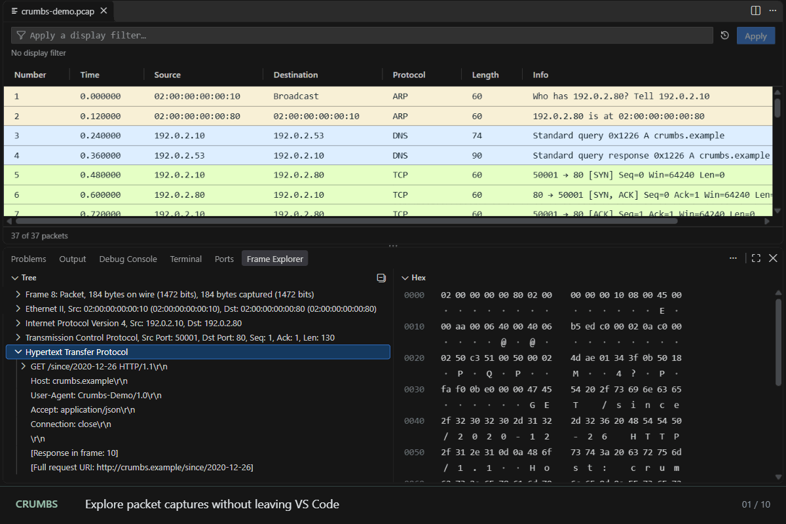

# Crumbs

**Follow the packets. Stay in your editor.**

Explore packet captures in VS Code with Wireshark's protocol dissection, familiar display filters, and synchronized hex inspection. Open a trace alongside your code and follow it from packet to field to byte.



## Made for following a trace

- **Wireshark inside VS Code.** Browse `.pcap`, `.pcapng`, and `.cap` files with a packet list, protocol tree, and hex/ASCII view.
- **Fields and bytes, connected.** Select a protocol field to highlight its bytes. Select bytes to reveal the smallest matching field in the tree.
- **Display filters with a little help.** Get validation as you type, autocomplete for protocols, fields and operators, and suggestions from values observed in the capture.
- **Filter directly from a field.** Apply or prepare a filter from the tree, including negation and AND/OR combinations.
- **Room to compare.** Open captures side by side, or split the same capture into panes with independent filters. Recent filters are shared across your local VS Code profile.
- **Comfortable to browse.** Virtualized packet and hex views, Wireshark packet colors, theme-aware selections, and hex/ASCII wrapping for narrower panels.

## Get started

1. Install **VS Code 1.108.1 or later** and [Wireshark](https://www.wireshark.org/download.html), including its `sharkd` executable.
2. Install **Crumbs**, then open a packet capture. If another editor opens it, right-click its tab and choose **Reopen Editor With… → Frame List**.
3. Double-click a packet to open **Frame Explorer**. Explore its protocol tree and select a field to see the corresponding bytes.

Standard Windows Wireshark installations are detected automatically. On macOS and Linux, `sharkd` should be on your PATH. For a custom installation, set **Crumbs: Sharkd** to the executable's full path. When using WSL, SSH, or a development container, install Wireshark on the machine running the extension host.

Crumbs reads existing captures; it does not record live traffic or edit packets. Capture processing runs through the local extension host and `sharkd`.

## Narrow down the conversation

Type a Wireshark display filter above the packet list, then press **Enter** or choose **Apply**:

```text
http
ip.addr == 192.0.2.80 && tcp
dns.qry.name == "crumbs.example"
http.response.code == 418
```

Use **↑/↓** to choose an autocomplete suggestion, **Tab** to insert it, and **Esc** to dismiss the list. Validation runs while typing; results change only when you apply a valid filter. To show all packets again, empty the field and press **Enter**.

Right-click a protocol-tree field for **Apply as filter** or **Prepare as filter**. Both offer **Selected**, **Not selected**, and **AND / OR / AND NOT / OR NOT** combinations with the currently applied filter. Prepare fills the bar so you can edit before applying.

The history button recalls your **20 most recently applied filters**. Choose one to edit, then press Enter to apply it. History stays local to your VS Code profile and is not included in Settings Sync. Observed-value suggestions come from a sample of the capture and packets you inspect, so they are not an exhaustive list of values.

### A small capture to explore

The [37-packet demo](samples/README.md) contains synthetic ARP, DNS, HTTP, TCP, ICMP, and UDP traffic. There is a nod to Crumbs' first commit on **26 December 2020**, a few networking jokes, and a server that would rather make tea. All addresses and names are examples; no real network traffic is included.

## Make it yours

Open Settings and search for **Crumbs**.

| Setting | What it controls |
| --- | --- |
| `crumbs.sharkd` | Automatic discovery, or a custom executable path. |
| `crumbs.profile` | Wireshark profile; defaults to `Default`. |
| `crumbs.frameList.columns` | Column names and Wireshark formats or display fields. |
| `crumbs.frameList.colorCoding` | Wireshark packet coloring; selections use VS Code theme colors. |
| `crumbs.frameHex.enableRowWrap` | Wrap ASCII below hex when space is limited. |
| `crumbs.frameHex.rowLength` | Bytes per row; defaults to `16`. |
| `crumbs.frameHex.setLength` | Bytes per group; defaults to `8`. |

Hex settings take effect immediately. Reopen a capture after changing its columns, packet colors, profile, or executable.

**Trouble opening a capture?** The error page offers relevant hints, **Open settings**, and **Show log**. Check that `sharkd` is installed and that the selected Wireshark profile exists, then choose **Try again**.

The **Crumbs (sharkd)** output channel includes sharkd version/build output, extension and host versions, capture/profile context, executable arguments, JSON-RPC requests and timings, process exit details, and complete error output. Successful packet responses are summarized by size. When reporting an issue, copy the log from session startup through the failure; it includes local file paths and display filters.

## Development

Use Node.js **22.22.2+ or 24.15+** and npm:

```sh
npm ci
npm run compile
npm test
```

Open the repository in VS Code, select **Run Extension**, and press **F5**. The launch task builds the extension and opens an Extension Development Host. Open `samples/crumbs-demo.pcap` there to try your changes; Wireshark is required to read the capture.

| Command | Purpose |
| --- | --- |
| `npm run watch` | Rebuild bundles as you edit. |
| `npm test` | Type checks, lint, and unit/component tests. |
| `npm run test:webview` | Playwright browser regressions. |
| `npm run test:integration` | Real VS Code + sharkd integration tests. |
| `npm run package` | Validate and build production bundles. |
| `npm run demo:capture` | Regenerate the synthetic demo capture. |

See the [development guide](docs/DEVELOPMENT.md) for browser setup, debugging, integration-test configuration, and asset generation.

## License & credits

[MIT](LICENSE) © Lukas Schneider. Built on [Wireshark](https://www.wireshark.org/). Wireshark is installed separately and retains its own license. See [ThirdPartyNotices.txt](ThirdPartyNotices.txt) for the VS Code Codicons used in the interface.
